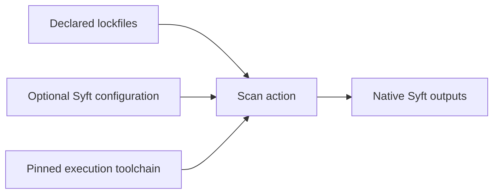
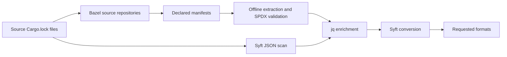

# Lockfile SBOM design

One Bazel action stages declared lockfiles and runs the Syft executable.
Without enrichment, the rule does not parse lockfiles or SBOM documents.



| Component                             | Responsibility                                                              |
| ------------------------------------- | --------------------------------------------------------------------------- |
| [Rule](private/rules.bzl)             | Check input contracts, declare outputs, and select the execution toolchain. |
| [Scan script](private/scan.sh)        | Copy inputs, isolate scratch directories, and run one Syft scan.            |
| [Settings](private/settings.bzl)      | Define output extensions and rule-owned Syft environment overrides.         |
| [Release data](private/releases.bzl)  | Define the version and platform constraints.                                |
| [Module extension](extensions.bzl)    | Download the pinned release archives.                                       |
| [Toolchain](toolchains/toolchain.bzl) | Supply the executable and its runfiles.                                     |

The scan directory contains regular files under `main/<path>` or `external/<repository>/<path>`.
Generated files use their repository-relative output paths.
Separate repository directories prevent collisions between equal filenames.
Duplicate scan paths fail during analysis.

The action uses a clean environment and always passes `--config`.
Without a supplied configuration, the rule writes an empty YAML file.
CLI arguments control the source, scan root, and output paths.
Environment overrides disable local dependency-cache searches.
By default, they also disable Syft network enrichment, and the CLI passes `--enrich none`.
With `allow_network = True`, the Syft configuration controls network enrichment.
Both direct scans and Cargo-enriched scans use this policy.
These overrides also disable update checks, caching, profiles, template paths, and extra log files.
The process receives scratch-local user, temporary, and XDG directories.
Offline actions request Bazel network blocking where the execution strategy supports it.
Online actions request network access and disable local and remote spawn caches.
The online action environment includes the `RULES_SBOM_REFRESH_KEY` build variable.
A new value changes the action key and prevents reuse from Bazel's persistent action cache.
Offline actions omit this variable.

The output group name equals the requested format string, including its version selector.
Each output path is `<target>/<format><extension>`.
The extension follows the encoding: `.json`, `.xml`, `.txt`, or `.spdx` for SPDX tag-value.
Version selectors stay in the filename before the extension.
Aliases use the same extension as the corresponding format.
Unknown format names keep their original filename so Syft can report unsupported formats.
The format string must contain only lowercase ASCII letters, digits, hyphens, underscores, periods, or `@`.
Empty strings, `.` and `..` are invalid.
Syft checks whether the format exists.

The shell action preserves Syft's exit status and diagnostics.
The rule does not reject successful empty inventories or inspect parser warnings.
It does not promise identical bytes between uncached builds.

## Cargo enrichment



The `cargo.from_lockfiles` extension uses `toml.bzl` to parse source lockfiles.
It fetches crates.io archives with their SHA-256 checksums.
It fetches public HTTPS Git repositories at locked commits through Bazel's Git repository rule.
The Git rule requires host Git.
It records tracked manifest paths before Bazel removes the Git metadata.
It does not initialize submodules.

The metadata repository declares published crate manifests and tracked Git manifests as build inputs.
It rejects manifest paths outside the source repository.
Source records contain the exact Cargo name, version, source string, and checksum.

Each generated `:licenses` target extracts and validates declarations in one offline Python action.
Python reads each source's manifests once with `tomllib`.
It resolves inherited versions and license declarations from declared workspace manifests.
It rejects ambiguous package matches without reading undeclared files.
The dependency lock pins `packaging` and its wheel hashes.
`rules_uv` maintains that lock, and `rules_python` supplies the interpreter and dependencies.
The tool emits complete native Syft license objects or unresolved reasons.
Each license keeps its raw declaration, canonical expression, and source evidence URL.
Custom license references remain unresolved because this version does not supply their definitions.

One jq invocation reads the SBOM and metadata files and matches complete source identities.
It preserves existing licenses and rejects conflicting records.
Warnings identify unresolved Cargo artifacts in the scanned SBOM.
The filter changes only missing license fields.
Syft converts the enriched native document to each requested output format.
The intermediate document uses the current Syft JSON representation, regardless of the requested output configuration.
Ordinary scan actions do not include jq or the enrichment filter as inputs.

The metadata format is internal and versioned.
Consumers use the generated target rather than construct metadata files.
Cargo source downloads happen before build actions.
Cargo metadata validation remains offline, including when the SBOM scan permits network enrichment.

## Custom toolchains

```starlark
load("@rules_sbom//toolchains:toolchain.bzl", "syft_toolchain")

syft_toolchain(
    name = "local_syft",
    syft = ":syft_binary",
)

toolchain(
    name = "local_syft_toolchain",
    toolchain = ":local_syft",
    toolchain_type = "@rules_sbom//toolchains:type",
    exec_compatible_with = [
        "@platforms//os:linux",
        "@platforms//cpu:x86_64",
    ],
)
```

Register the custom toolchain in the consuming module's `MODULE.bazel`.
The executable must support the CLI and configuration controls in the scan script and settings file.
Test these controls before selecting another Syft version.

## Tests

The tests cover combined scans, output groups, configuration overrides, generated inputs, external inputs, and undeclared adjacent files.
Analysis tests cover input errors and toolchain selection for all four platforms.
A custom executable checks action isolation, declared tool runfiles, and network policy for direct and Cargo-enriched scans.
Failure checks verify native format errors and custom executable exit status.
The independent consumer checks Bzlmod use without development dependencies.
Python tests cover manifest errors, workspace inheritance, and SPDX expressions.
Integration tests cover complete source identities, preserved licenses, and output conversion.
Local archive and Git fixtures check source acquisition, locked commits, download failures, and checksum failures.
